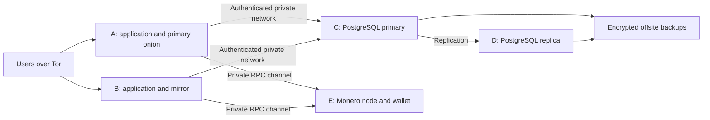

# Deployment, servers and expansion

Planning baseline: **September 12, 2026**. This topology is proposed; complete provisioning automation is not included. For the initial release without public mirrors, follow the [single-onion production launch runbook](PRODUCTION_LAUNCH_SINGLE_ONION.md). See [hosting and budget](ONION_HOSTING.md) and [wallet operations](WALLET_PRODUCTION_RUNBOOK.md).

## Five-server topology

Use two active applications, a PostgreSQL primary, a recovery replica and a separate financial server. Only the primary accepts database writes; only one instance opens the spending wallet.

| Server | Role | Initial proposed capacity |
| --- | --- | --- |
| A | Tor, Nginx, Next.js; primary onion | 2 vCPU, 4 GB RAM, 50–80 GB SSD |
| B | Tor, Nginx, Next.js; active mirror | 2 vCPU, 4 GB RAM, 50–80 GB SSD |
| C | Separate PostgreSQL primary | 2–4 vCPU, 8 GB RAM, 90–160 GB SSD |
| D | PostgreSQL recovery replica | Similar to primary |
| E | Monero node, wallet RPC, financial routines | 4 vCPU, 8–16 GB RAM, 400–500 GB SSD for a pruned node |

These are initial estimates for moderate traffic without load measurements. Queries, images, connections and PGP operations may require more capacity. Leave headroom for database data, indexes and WAL.

Do not expose database or wallet RPC ports publicly. Remote wallet access requires validated private forwarding.

## Alternative sizes

| Scenario | Distribution | Limitation |
| --- | --- | --- |
| 4 servers total | 2 applications + database + financial server | Database and wallet are single points of failure |
| 5 servers total | 2 applications + primary + replica + financial server | Controlled database recovery; wallet remains single |
| 5 prioritizing web capacity | 3 applications + database + financial server | More mirrors, no database replica |
| 4–5 application servers only | Applications + 2 databases + financial server = **7–8 total** | More budget and coordination |

Several onion addresses can share one VPS but fail together. Place at least the two applications in separate providers or failure domains.

## Database continuity

Every application uses one transactional database. Never maintain independent balances per mirror. Keep applications and primary geographically close; a replica can use a nearby separate datacenter.

Start with controlled manual promotion. Fence the old primary against writes and verify replay progress before promotion. Asynchronous replication can lose recent transactions; synchronous replication trades latency and availability for lower data-loss risk. A replica alone provides neither consensus nor safe automatic promotion. Plan quorum and fencing before automation. [PostgreSQL standby documentation](https://www.postgresql.org/docs/current/warm-standby.html).

Define and test recovery objectives, such as a 30-minute recovery target and an explicitly accepted recovery point. These are targets, not guarantees. Configure offsite retention and WAL archiving for point-in-time recovery. Database backups do not replace wallet or onion identity backups.

`src/lib/db.ts` creates a pool per process. Budget connections for applications, workers, tools and temporary blue/green overlap. Consider PgBouncer after testing transaction and prepared-statement compatibility.

## Active mirrors

Onion addresses share database, release and authentication configuration. Cookies are hostname-specific; switching mirrors may require login again. `PublicMirror`, `ONION_URL` and `PUBLIC_ONION_MIRRORS` register addresses for display; they do not configure Tor or verify uptime. `ONLINE` in the database does not replace a real Tor request.

For one address distributed across Tor instances, evaluate Onionbalance v3 with its descriptor/instance architecture. Copying the same key into independent services is not load balancing. Budget redundant managers if they require extra hosts. [Onionbalance](https://onionservices.torproject.org/apps/base/onionbalance/man/onionbalance/).

## Consistent releases

Build one Linux-compatible artifact and distribute the same build. Share `SESSION_SECRET`, `AUTH_SALT` and `NEXT_SERVER_ACTIONS_ENCRYPTION_KEY`; the latter must exist during build. Keep the previous release during cutover and test already-open forms. Coordinate cache invalidation and never publicly cache sessions. [Next.js self-hosting](https://nextjs.org/docs/app/guides/self-hosting).

Run migrations once with a validated backup. The monetary migration uses `DECIMAL(30,12)` and audit snapshots; no further integer conversion is needed. Blue/green on ports 3000/3001 provides local release switching, not two independent hosts.

## Repository support and destination work

| Repository support | Destination work |
| --- | --- |
| Server-controlled Nginx upstream; client selection headers ignored | Validate Nginx configuration, probes, cutover and rollback |
| Tor sample forwards to loopback Nginx on 8080 | Configure per-host directories and protect identities |
| Readiness checker requires localhost RPC | Configure private local forwarding to financial host |
| Digest negotiation and local HTTP tests | Validate a real stagenet wallet through the tunnel |
| Separate process, database and wallet health routes | Install probes and alerts; wallet probe requires Bearer |
| Scanner advisory lock and systemd timer | Install on financial host; monitor lag and failures |
| Revenue payouts reserve funds and use shared withdrawals | Rehearse recovery and reconcile historical cash |
| Media/cache may depend on instance | Audit storage and share persistent uploads before replication |

Digest follows [official wallet RPC examples](https://docs.getmonero.org/rpc-library/wallet-rpc/). Local tests do not prove target connectivity.

## Release procedure

Use `.env.example` for variables, especially `DATABASE_URL`, `SESSION_SECRET`, `AUTH_SALT`, `SETUP_KEY`, `ADMIN_URL_SECRET`, `ADMIN_MSID`, `ONION_URL`, `PUBLIC_ONION_MIRRORS`, `SERVER_ACTION_ALLOWED_ORIGINS`, `ADMIN_XMR_ADDRESS`, `XMR_RPC_URL`, `XMR_RPC_USER`, `XMR_RPC_PASS` and `WALLET_SYNC_SECRET`. Keep secrets outside Git and documentation.

1. Run `npm ci` and `npx prisma generate`.
2. Run `npm run check`, local integration tests and browser tests.
3. Validate restoration and migration compatibility with cutover.
4. Run `npx prisma migrate deploy` once at the destination.
5. Start supervised processes under a dedicated user on loopback, for example `npm run start -- --hostname 127.0.0.1 --port 3000`.
6. Test authentication, reading and forms through Tor on each mirror; validate the wallet separately.
7. Record release, migrations, operators and rollback procedure.

Feature flags never replace authorization. Operational logs need retention limits and must exclude PINs, passwords, private keys and private messages.

## Runtime configuration

Use Node.js 22.12+ on line 22 or Node.js 24. `deploy/market-app@.service` expects user `market`, releases `/srv/market/blue` and `/srv/market/green`, common environment `/etc/market/app.env`, and `PORT` in `/etc/market/blue.env` (3000) and `/etc/market/green.env` (3001). Make `.next/cache` writable by that user.

Use 32 random bytes encoded as Base64 for `NEXT_SERVER_ACTIONS_ENCRYPTION_KEY`, shared during build and runtime. Replicas of one artifact share `DEPLOYMENT_ID`. `DATABASE_POOL_MAX` controls each process pool. Check release health before switching Nginx upstream and reloading.

Before release: dependency audit, `npm run check`, integration/browser tests, backup/restore, migrations, `npm run prod:check` and `npm run wallet:reconcile`. Rehearse application loss, fenced database promotion and wallet recovery. Never promote a replica solely on a lost connection.

## Local evidence and limits

Browser tests use disposable PostgreSQL and Chromium without JavaScript. `skipProxyUrlNormalize` preserves proxy destinations; relative form redirects retain the incoming mirror. Do not replace these with localhost redirects.

Additive migrations provide challenges, session versions and fee receipts. The previous local backup is `backups/market-20260912-185838-784.dump`. PIN/PGP changes revoke sessions and proofs; authentication throttling uses UTC and atomic database updates.

The UI and general documentation use English; the single-onion production runbook is maintained in Brazilian Portuguese. Administrators and moderators have separate workspaces and verification routes; see [staff setup](ADMIN_INIT.md).

Provisioning, private networking, replication, offsite backups, onion/wallet recovery, alerts, Tor navigation, load tests and destination failover/restore remain environment-dependent. Before real funds, complete stagenet financial cycles and opening cash reconciliation. No servers have been purchased or deployed in these local changes.
